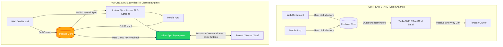
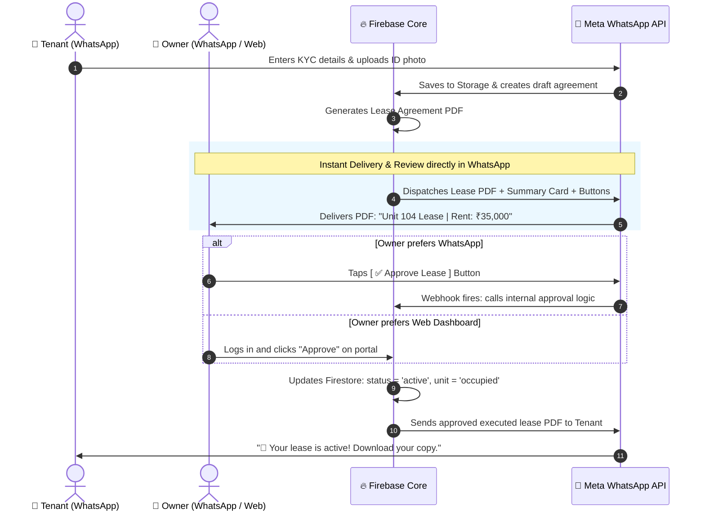
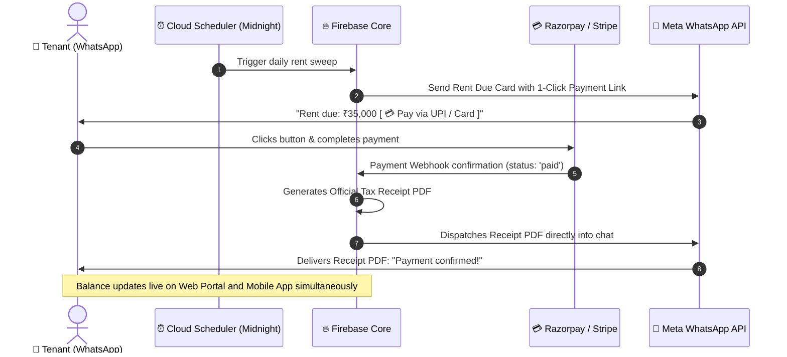
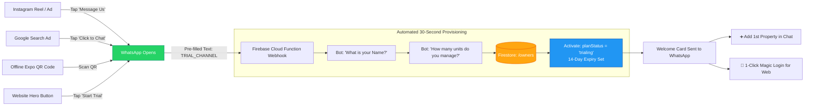

# Propithub: Visual Architecture & Transition Guide
## Expanding from Dual-Channel (Web + Mobile) to Tri-Channel with WhatsApp Superpower

**Document Version:** 1.0.0  
**Target Codebase:** `Propithub_v2` (Firebase Core, React/TS Web, Expo Mobile, Meta WhatsApp Cloud API)  
**Date:** October 14, 2026  

---

## 1. The Core Concept: An Additive Superpower (Not a Replacement)

> [!IMPORTANT]
> **Full Feature Parity Maintained**: All features and workflows remain 100% operational on the **Web Management Portal** and the **Expo Mobile App**. WhatsApp does not replace them. Instead, WhatsApp acts as an **additive conversational superpower**—a zero-friction "remote control" allowing users to interact with Propithub from wherever they are, without opening a browser or logging into an app.

```
                               ┌────────────────────────────────────────────────────────┐
                               │             THE TRI-CHANNEL PROPIDHUB FRONTEND         │
                               └──────────────────────────┬─────────────────────────────┘
                                                          │
          ┌───────────────────────────────────────────────┼───────────────────────────────────────────────┐
          ▼                                               ▼                                               ▼
┌──────────────────┐                            ┌──────────────────┐                            ┌──────────────────┐
│    Web Portal    │                            │    Mobile App    │                            │   WhatsApp Bot   │
│ (React/TS + Vite)│                            │  (Expo / React   │                            │ (Meta Cloud API  │
│                  │                            │     Native)      │                            │  Conversational) │
├──────────────────┤                            ├──────────────────┤                            ├──────────────────┤
│ • Bulk Config    │                            │ • Resident Push  │                            │ • 1-Click Action │
│ • Deep Analytics │                            │ • Digital Key    │                            │ • Voice/Photo In │
│ • Heavy Audits   │                            │ • In-App Chat    │                            │ • Zero-App UX    │
└─────────┬────────┘                            └─────────┬────────┘                            └─────────┬────────┘
          │                                               │                                               │
          └───────────────────────────────────────────────┼───────────────────────────────────────────────┘
                                                          │
                                                          ▼
                               ┌────────────────────────────────────────────────────────┐
                               │           UNIFIED FIREBASE BACKEND ENGINE              │
                               │                                                        │
                               │  • Firestore Database (`agreements`, `invoices`, etc.) │
                               │  • Firebase Cloud Storage (PDFs, Media, KYC)           │
                               │  • Cloud Functions Logic (`signAgreement`, etc.)       │
                               │  • Payment Gateways (Razorpay / Stripe)                │
                               └────────────────────────────────────────────────────────┘
```

---

## 2. The Architectural Transition (Before vs. After)



---

## 3. Visual Workflow 1: Tenant Onboarding & 1-Click Owner Approval

This illustrates how an agreement can be drafted, reviewed, approved, and activated entirely within WhatsApp or interchangeably across Web/Mobile:



---

## 4. Visual Workflow 2: Rent Invoicing & Direct Payments



---

## 5. Visual Workflow 3: Omnichannel Marketing to Instant Free Trial

How an owner goes from seeing an ad to starting a live 14-day trial in 30 seconds:



---

## 6. What Can Be Done Where (Tri-Channel Matrix)

| Operational Action | Web Portal | Mobile App | WhatsApp Superpower | Best Used For |
| :--- | :---: | :---: | :---: | :--- |
| **New Lead Trial Onboarding** | ✅ Yes | ✅ Yes | ⚡ **Fastest (30s)** | Social ads, QR codes, cold leads |
| **Review & Approve Lease** | ✅ Yes | ✅ Yes | ⚡ **Instant (1-Tap)** | Owners on the move |
| **Rent Reminder & Pay** | ✅ Yes | ✅ Yes | ⚡ **Direct Link/UPI**| Highest open and conversion rate (>95%) |
| **Log Maintenance Ticket** | ✅ Yes | ✅ Yes | ⚡ **Voice / Photo** | Tenants without app installation |
| **Field Tech Job Updates** | ✅ Yes | ✅ Yes | ⚡ **Quick Buttons** | Technicians who don't open portals |
| **Bulk 50-Unit Import** | 💻 **Optimal** | ⚠️ Complex | ❌ Not suited | Initial landlord onboarding |
| **Consolidated P&L Audits** | 💻 **Optimal** | ⚠️ Summary only| ❌ Summary only | End-of-year tax accounting |

---

## 7. Immediate Next Steps to Implement This

Here is the exact step-by-step checklist to begin execution:

### Step 1: Meta Business & WhatsApp API Setup (Day 1)
- [ ] Go to [developers.facebook.com](https://developers.facebook.com) and create a **Business App**.
- [ ] Add the **WhatsApp** product to your app.
- [ ] Link or create your **Meta Business Manager** account.
- [ ] Register your dedicated business phone number (or start with Meta’s free Test Phone Number for sandbox testing).
- [ ] Generate a permanent **System User Access Token** with `whatsapp_business_messaging` permissions.

### Step 2: Create the Firebase Webhook Endpoint (Day 2)
- [ ] In `Propithub_v2/functions/src/index.ts`, add an HTTPS endpoint: `export const whatsappWebhook = functions.https.onRequest(...)`.
- [ ] Handle Meta’s **Verification Challenge** (`hub.mode`, `hub.verify_token`, `hub.challenge`).
- [ ] Paste the webhook URL into your Meta App Dashboard and click **Verify and Save**.
- [ ] Subscribe to the `messages` event.

### Step 3: Implement Phone-to-User Role Resolver (Day 3)
- [ ] When a message arrives at the webhook, extract the sender’s phone number: `const phone = payload.entry[0].changes[0].value.messages[0].from`.
- [ ] Query Firestore `/users` by phone number:
  - If role == `'owner'` ➔ Return Owner Quick-Action Menu.
  - If role == `'tenant'` ➔ Return Tenant Action Menu.
  - If role == `'staff'` ➔ Return Field Technician Worklist.
  - If not found ➔ Route to Lead / Free-Trial Onboarding flow.

### Step 4: Plug in the 1-Click Owner Lease Approval (Day 4)
- [ ] When a new lease is created in `agreements`, send an interactive WhatsApp message to the owner’s phone with:
  - Attachment: The agreement PDF URL.
  - Two buttons: `[ ✅ Approve ]` and `[ ❌ Reject ]`.
- [ ] In the webhook handler, catch `type === 'interactive'` and button ID `approve_lease_{agreementId}`.
- [ ] Call the existing `signAgreement` / update logic to mark the lease active and the unit occupied.

### Step 5: Connect Daily Rent Reminders to WhatsApp (Day 5)
- [ ] In `functions/src/index.ts` under `dispatchDailyRentReminders`, add WhatsApp delivery alongside the existing SMS and email calls.
- [ ] Send an interactive message with a direct link button pointing to your Razorpay/Stripe checkout URL.
- [ ] Confirm receipt PDF delivery on payment success in `onRentalInvoiceWrite`.

### Step 6: Launch Omnichannel Marketing Funnel (Day 6)
- [ ] Generate your tracking deep links (`wa.me/<NUMBER>?text=TRIAL_INSTA`, `wa.me/<NUMBER>?text=TRIAL_EXPO`).
- [ ] Set up the handler: when an incoming message starts with `TRIAL_`, automatically create an owner profile with `planStatus: 'trialing'` and send the interactive welcome card.
